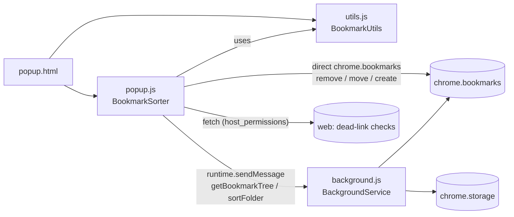

# 🗺️ Chrome Bookmarks Sorter — Workspace Map

> [!NOTE]
> **What this is** — a Manifest V3 Chrome extension: a popup that works on the
> bookmark tree, plus a service worker that does folder sorts and lifecycle tasks.
> Plain JS, no build step.

Files: see the **Key Files** table in `CLAUDE.md`. Features/usage: `README.md`.
Install: `INSTALLATION.md`. Manual tests: `TEST_GUIDE.md`.

## Anatomy

Three runtime pieces. The popup loads `utils.js` then `popup.js` (in that order, from `popup.html`).

| Piece | File | Key symbols |
|---|---|---|
| Popup controller | `popup.js` | `BookmarkSorter` (`init`, `loadBookmarks`, `bindEvents`) — created on `DOMContentLoaded` |
| Shared helpers | `utils.js` | `BookmarkUtils` (all `static`) — popup-only; the service worker does not import it |
| Service worker | `background.js` | `BackgroundService` (`setupEventListeners`, `handleMessage`) — created at top level |



### Popup UI → handler

| Button / control (`id`) | `BookmarkSorter` method | Main helpers |
|---|---|---|
| `folderSelect`, `sortCriteria`, `sortBtn` | `sortBookmarks` → `sortAllBookmarks` (for "all") | message `sortFolder` to the service worker |
| `removeDuplicatesBtn` | `removeDuplicates` | `BookmarkUtils.findDuplicates` |
| `organizeByDomainBtn` | `organizeByDomain` | `BookmarkUtils.groupByDomain`, `extractDomain` |
| `cleanupBtn` | `cleanupEmptyFolders` | `BookmarkUtils.findEmptyFolders` |
| `linkHealthScope`, `checkDeadLinksBtn` / `cancelLinkCheckBtn` | `checkDeadLinks` / `cancelLinkCheck` | `BookmarkUtils.checkDeadLinks` → `checkSingleLink`; `generateDeadLinksReport`, `downloadDeadLinksReport` |
| `backupBtn` | `createBackup` | `BookmarkUtils.createBackup` → downloaded as JSON |
| `restoreBtn` → `restoreInput` | `restoreBackup` | `BookmarkUtils.validateBackup` — **validates only; no restore yet** |
| `totalBookmarks`, `totalFolders`, `duplicateCount` | `updateStatistics` | `BookmarkUtils.getBookmarkStats` |
| `statusMessage`, `progressContainer`, `linkCheckProgress` | — | `BookmarkUtils.showStatus`, `updateProgress`, `updateLinkProgress` |

Root folder IDs are hard-coded in `getBookmarksByScope` / `getFolderIdByScope`:
`'1'` Bookmarks bar, `'2'` Other bookmarks, `'3'` Mobile bookmarks.

### Service-worker messages (`BackgroundService.handleMessage`)

| `message.type` | Handler | Called by popup? |
|---|---|---|
| `getBookmarkTree` | `chrome.bookmarks.getTree` | yes (`loadBookmarks`) |
| `sortFolder` | `sortFolder` → `sortBookmarkArray` (reorders with `chrome.bookmarks.move`) | yes |
| `getBookmarkStats`, `performSort`, `createBackup`, `getSettings`, `updateSettings` | same-named methods / storage | no |

> [!NOTE]
> Sorting has two code paths, and only one is used. The service worker's `sortBookmarkArray` does the
> real sort. `BookmarkUtils.sortBookmarks` and `BookmarkSorter.sortBookmarksInFolder`
> are never called.

## Data stores & persistence

| Store | Written by | Keys / note |
|---|---|---|
| `chrome.bookmarks` | popup and service worker | The real data; the popup keeps a copy of the tree in memory from `loadBookmarks` |
| `chrome.storage.sync` | `handleFirstInstall`, `createBackup`, `updateSettings` | `autoSortEnabled`, `defaultSortBy`, `backupEnabled`, `lastBackupDate` |
| `chrome.storage.local` | `BackgroundService.createBackup` | `backup_<timestamp>` — automatic backup, triggered on startup by `checkAutoBackup` when ≥7 days have passed |
| Downloaded file | `BookmarkSorter.createBackup` | `bookmarks-backup-YYYY-MM-DD.json` |

Service-worker globals do not persist (MV3); see `CLAUDE.md`.

## Data schema

```jsonc
// Backup (BookmarkUtils.createBackup — popup download)
{
  "version": "1.0",
  "timestamp": 0,              // ms since epoch
  "date": "ISO-8601",
  "bookmarks": [ /* chrome.bookmarks.getTree() result: N nodes */ ],
  "stats": { /* BookmarkUtils.getBookmarkStats */ }   // absent in the service-worker auto-backup
}
```
`validateBackup` requires `version`, `timestamp`, and an array `bookmarks`.

## External pieces

- **Chrome itself**: load unpacked at `chrome://extensions/`. No packaged build is in the repo (`*.zip`/`*.crx` are gitignored).
- **Network**: `host_permissions` for `http://*/*` and `https://*/*` exist only for the dead-link checker's `fetch` calls.
- **Icons**: `icons/` has only `.txt` placeholders + `icons/README.md`; `manifest.json` declares no icons.
- No tests, scheduled tasks, secrets or remote hosts.

## Git

- Remote `origin` → `github.com/vtak007/Chrome-Bookmarks-Sorter` (public).
- Feature branches merged into `main` (see global `CLAUDE.md`).
- `.remember/` is local session scratch and is not tracked.

## Working notes

Run: Developer mode → Load unpacked → project folder. After editing, click reload on the extension card. To debug the popup, right-click it → Inspect. To debug the service worker, use its "service worker" link on the card.

| I want to… | Go to |
|---|---|
| Add a popup button | `popup.html` + `BookmarkSorter.bindEvents` |
| Change sort order logic | `BackgroundService.sortBookmarkArray` |
| Change duplicate rules | `BookmarkUtils.findDuplicates` |
| Tune dead-link detection | `BookmarkUtils.checkSingleLink`, `BookmarkUtils.checkDeadLinks` |
| Change the dead-link report | `BookmarkUtils.generateDeadLinksReport` |
| Implement restore | `BookmarkSorter.restoreBackup` |
| Change default settings | `BackgroundService.handleFirstInstall` |
| Change auto-backup interval | `BackgroundService.checkAutoBackup` |
